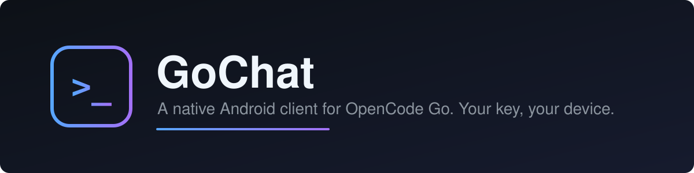
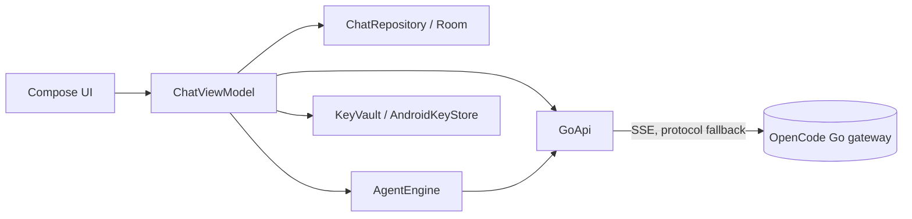

<p align="center"></p>

<p align="center">
  <a href="LICENSE"></a>
  <a href="https://github.com/chsxthwik/OPENCODE-GO-CHAT/actions/workflows/android.yml"></a>
  
  
  <a href="https://github.com/chsxthwik/OPENCODE-GO-CHAT/commits/main"></a>
</p>

# GoChat

A native Android chat client for [OpenCode Go](https://opencode.ai/docs/go/). Paste one API key, pick from the models the Go gateway offers, and chat. Conversations stay on your device.

## Features

- **Live model list** from the Go gateway, grouped picker, per-model protocol routing (`/chat/completions`, `/responses`, `/messages`) with automatic fallback to the other endpoints
- **Streaming replies** over SSE with a thinking indicator and stop button
- **Agent mode** that plans, runs steps and verifies, with an approval step and a resumable timeline
- **Markdown** rendering: headings, lists, quotes, links, tables, fenced code with per-block copy
- **Multi-chat** storage (Room): auto-titles, rename, fork from any message, search across history, per-conversation instructions
- **Message actions**: copy, share, edit and resend, regenerate (optionally with another model), delete from here, resume interrupted replies
- **Attachments**: code and documents as fenced context, images on vision models (auto-downscaled)
- **Controls**: context-window slider, temperature, system prompt, token and latency readout, notification when a reply finishes in the background
- **Custom gateway URL**: https, or plain http on localhost and LAN addresses only
- **Private**: API key encrypted with AES-256/GCM in the AndroidKeyStore, backups disabled, no analytics

## Install

Download the debug APK from the latest successful run of the [CI workflow](https://github.com/chsxthwik/OPENCODE-GO-CHAT/actions/workflows/android.yml) (Artifacts), or build it yourself:

```bash
./gradlew assembleDebug   # app/build/outputs/apk/debug/app-debug.apk
./gradlew testDebugUnitTest
```

Requires JDK 17 and the Android SDK 34.

## Usage

1. Subscribe to OpenCode Go at [opencode.ai/zen](https://opencode.ai/zen) and copy your API key.
2. Paste it in GoChat and tap Connect. The key is checked against `/models` and stored encrypted.
3. Pick a model and chat.

The app sends a stable `x-opencode-session` header per install so the gateway can route and cache requests.

## How it works



Transient failures (network, 5xx, rate limit) get one backoff retry per endpoint. Bad keys, quota errors and other 4xx responses stop immediately.

## Limits

- Debug builds are what CI produces; there is no signed release or store listing.
- Vision support is detected from the model id, so some vision models may not be flagged.

## License

MIT. See [LICENSE](LICENSE).
